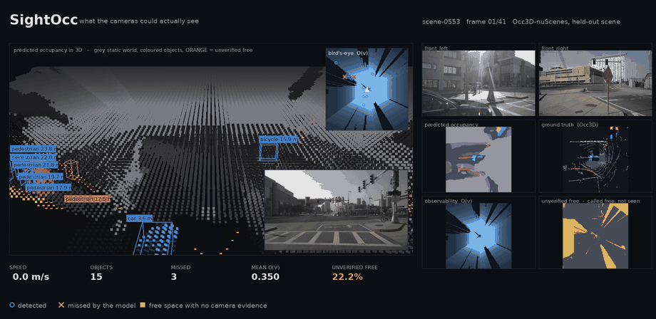
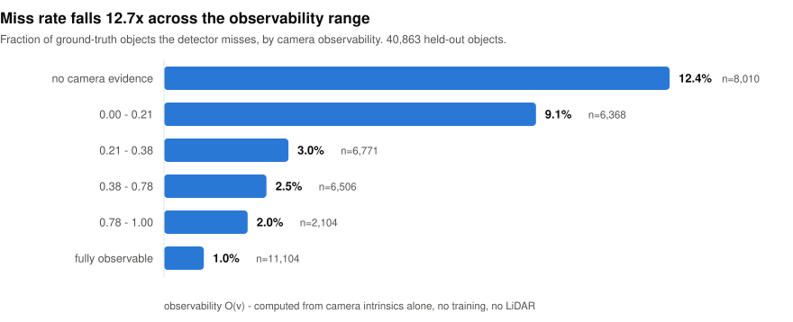
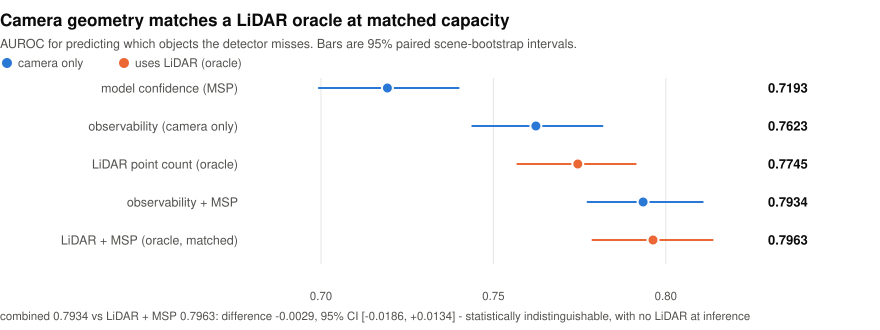
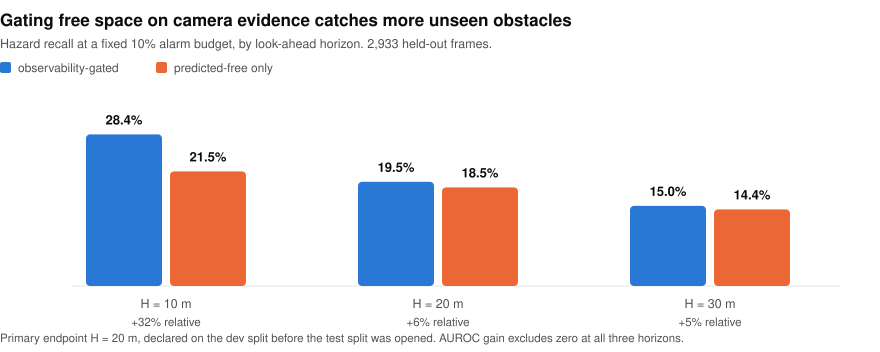

<h1 align="center">SightOcc</h1>

<p align="center">
  <b>A camera-only occupancy model cannot tell "empty road" from "I could not see."</b><br>
  SightOcc measures the difference, from camera geometry alone. No training. No LiDAR.
</p>

<p align="center">
  <a href="https://github.com/AkilanManivannanak/opendrivefm/actions"></a>
  
  
  
  <a href="https://akilanmanivannanak.github.io/opendrivefm/"></a>
</p>

<p align="center">
  
</p>

<p align="center">
  <sub><b>One held-out scene, 40 frames at 12 m/s, 2560&times;1600, every panel
  read from the dataset.</b> The hero is CAM_FRONT at its native 1600&times;900
  with the occupancy projected onto the road plane: <b>teal</b> where the model
  calls the road clear <i>and</i> the cameras saw it, <b>orange</b> where it calls
  it clear on almost no evidence. Objects carry their nuScenes instance ids and
  are tracked across frames, and the table lists every currently missed object
  with its range, its observability, and how many consecutive frames it has been
  missed. 20.5% of annotated objects in this scene are missed.<br>
  <b><a href="https://akilanmanivannanak.github.io/opendrivefm/viewer/">Open the interactive viewer</a></b>
  &middot; <a href="docs/figs/demo.mp4">full-resolution video</a>
  &middot; regenerate with <code>scripts/figs/make_demo_video.py</code></sub>
</p>

<p align="center">
  <sub>The viewer is the same scene, live in the browser: orbit it, scrub the 41
  frames, and toggle observability shading, the unverified-free overlay and the
  object boxes. 1.9 MB of frame data, no server, no CDN.</sub>
</p>

---

<p align="center">
  <picture>
    <source media="(prefers-color-scheme: dark)" srcset="docs/figs/bands-dark.svg">
    
  </picture>
</p>

---

### The measure

```
O(v) = max_i  c_i(v) · s_i(v)

  c_i(v)   projected coverage     min(1, (f_i·r / d)² / pi_full)
  s_i(v)   first-hit visibility   per-pixel ray marching

  parameters: 1  (pi_full = 965 px)        learned components: 0
```

How much image area a voxel-sized object would occupy in camera *i*, times whether
anything blocks it. Computable at deployment from intrinsics and extrinsics.

---

<p align="center">
  <picture>
    <source media="(prefers-color-scheme: dark)" srcset="docs/figs/auroc-dark.svg">
    
  </picture>
</p>

<p align="center">
  <picture>
    <source media="(prefers-color-scheme: dark)" srcset="docs/figs/downstream-dark.svg">
    
  </picture>
</p>

---

### Results

| | AUROC | 95% CI | artifact |
|---|---|---|---|
| model confidence (MSP) | 0.7193 | [0.6994, 0.7399] | `combined_object.json` |
| **observability** | **0.7623** | [0.7439, 0.7816] | `combined_object.json` |
| LiDAR point count *(oracle)* | 0.7745 | [0.7570, 0.7913] | `combined_object.json` |
| **observability + MSP** | **0.7934** | [0.7773, 0.8107] | `combined_object.json` |
| LiDAR + MSP *(oracle, matched)* | 0.7963 | [0.7788, 0.8136] | `combined_object.json` |

Combined minus the capacity-matched oracle: **−0.0029, CI [−0.0186, +0.0134]**.

---

<details>
<summary><b>What we could not show</b> — three negative results, reported at full weight</summary>

<br>

| | result |
|---|---|
| Calibration | observability does **not** improve it. ECE contrast +0.0026 [−0.0026, +0.0058], spans zero |
| Non-free voxels | a sensor-visibility mask **beats** observability, −0.0033 [−0.0051, −0.0015] |
| First downstream test | **failed**, and the failure was our own: the hazard window was `v²/2a`, so the label was confounded with speed. Speed alone scored 0.6250. Diagnosed on dev, corrected with a fixed-range window, speed alone fell to 0.285 |

Three of five pre-registered hypotheses failed. All are in the log with the same
weight as the ones that passed.

</details>

<details>
<summary><b>Method freeze</b> — 5,500 lines, A1 to A82, every threshold fixed before its run</summary>

<br>

`docs/METHOD_FREEZE.md` records each hypothesis, its acceptance criterion, and the
result, in that order. The test split is sealed under digest `924a44db544d4818`,
enforced in code by `scripts/eval/split.py`, and was opened once.

Selection errors we caught in our own work and corrected, rather than shipped:

- **A78** — the oracle contrast compared a two-feature fitted model against one raw
  feature. At matched capacity the gap vanished. The "beats LiDAR" claim was withdrawn.
- **A81** — the downstream endpoint was first chosen by largest effect. Largest effect
  had the least power and failed on dev. Re-chosen by power before test was opened.
- **A66** — a release gate was mis-specified and would have rejected the reference
  model's own output.

</details>

<details>
<summary><b>Reproduce</b></summary>

<br>

Each measured artifact has exactly one producer:

```
scripts/eval/split.py                  sealed dev/test split and its digest
scripts/eval/build_observability_ray.py  the observability maps
scripts/eval/missed_detection.py       miss rate by observability band
scripts/eval/combined_object.py        object-level AUROCs, A76-A78
scripts/eval/a79_safety_downstream.py  downstream hazard test, A79/A81
scripts/eval/weighted_miou.py          standard and O(v)-weighted Occ3D mIoU
scripts/eval/a56_fullpx.py             pi_full sensitivity
scripts/figs/make_readme_figs.py       the three result figures above
scripts/figs/make_demo_video.py        the demo reel
scripts/figs/export_viewer.py          the interactive viewer's frame data
```

```bash
python3 scripts/eval/combined_object.py --boot 2000 \
    --out outputs/artifacts/combined_object.json
```

Most take `--obs`, `--boot`, `--out`; run any with `-h`. They need the packed
observability maps under `data/pack/`, which are not in the repository.

Figures regenerate from the committed JSONs with
`python3 scripts/figs/make_readme_figs.py` — no data, no GPU.

The demo clip regenerates with `python3 scripts/figs/make_demo_video.py --scene scene-0553`,
which needs the packed maps and the nuScenes images.

</details>

<details>
<summary><b>Pipeline validity</b></summary>

<br>

All three evaluated models reproduce their published Occ3D-nuScenes mIoU:

| model | ours | published |
|---|---|---|
| FB-OCC | 38.92 | 39.10 |
| FlashOcc M2 | 38.00 | 37.84 |
| FlashOcc M1 | 31.91 | 32.08 |

</details>

---

<p align="center">
  <a href="https://akilanmanivannanak.github.io/opendrivefm/"><b>Project page</b></a> ·
  <a href="https://akilanmanivannanak.github.io/opendrivefm/viewer/"><b>Interactive viewer</b></a> ·
  <a href="docs/METHOD_FREEZE.md"><b>Method freeze</b></a> ·
  <a href="outputs/artifacts/"><b>Artifacts</b></a>
</p>

<p align="center">
  <sub>Akila Lourdes Miriyala Francis · Akilan Manivannan</sub>
</p>
